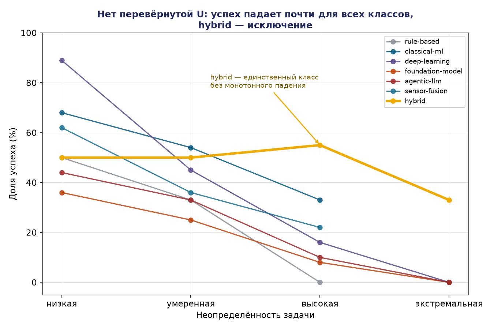
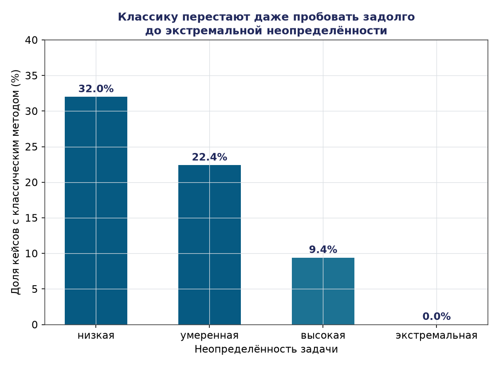
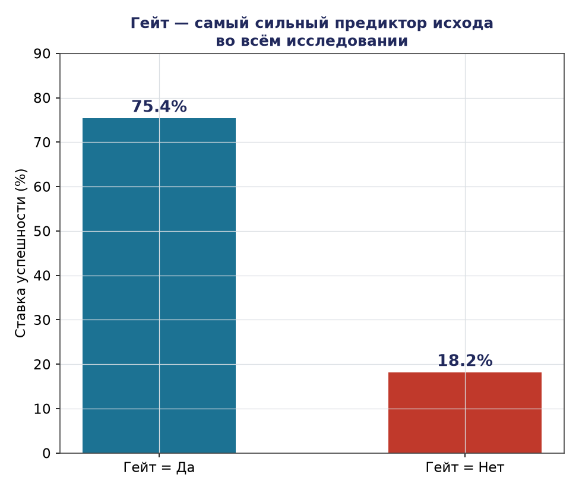
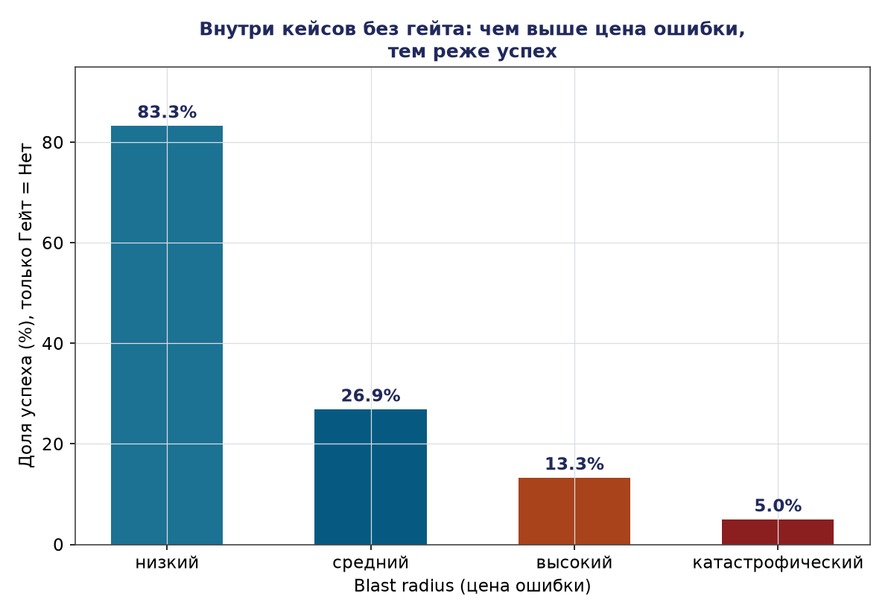

# Резюме: от четырёх гипотез к двум осям + отдельной оси риска

## Итог для владельца курса: строить или не строить

**Да, как педагогическая рамка курса — две оси технической применимости плюс отдельно стоящая
ось цены ошибки.** Это финальная версия после полного эмпирического цикла на каноническом
реестре 421 реального кейса (`reestr-reshenij.csv`, лекции 4-15): исходные «4 оси» (неопределённость,
скорость обратной связи, сложность модели, гейт) схлопнулись в это по итогам прямой проверки, а не
по умолчанию. Формулировка владельца по итогам файла 08 — «кажется мы нащупали две оси» — ниже
развёрнута честно, с оговоркой: это «две ядровые оси применимости + одна отдельная ось риска»,
а не буквально две оси вообще; слияние гейта в оставшиеся две — рекомендация оркестратора (файл 09
§3), пока не переподтверждённая владельцем дословно.

**Три числа, которые держат всю рамку:**

1. **Гейт/обратимость — самый сильный предиктор исхода во всём исследовании.** 75,4% успеха при
   наличии гейта против 18,2% без него (файл 07 §1) — разрыв больше, чем у обеих осей по
   отдельности. Внутри кейсов без гейта исход дополнительно градуируется ценой ошибки: 83,3% →
   26,9% → 13,3% → 5,0% от низкого к катастрофическому blast radius (файл 07 §3).
2. **Классику перестают пробовать, а не «классика проигрывает».** Доля кейсов на классических
   методах падает 32,0% → 22,4% → 9,4% → 0,0% по мере роста неопределённости (файл 09 §1) — на
   экстремальном уровне классики в корпусе просто нет ни одной строки.
3. **У ИИ тоже есть потолок — но это потолок попытки, не успеха.** Deep-learning, foundation-model
   и agentic-llm документированы как применяемые вплоть до экстремальной неопределённости — но
   успешность там у всех троих 0% (файл 09 §2.3). Настоящая зона, где сложность метода
   действительно окупается, — умеренная/высокая неопределённость, не крайний хвост.

### Графики

Успех падает почти монотонно для 6 из 7 классов метода по мере роста неопределённости; `hybrid`
(детерминированное/человеческое ядро в контуре) — единственное устойчивое исключение. Данные —
файл 08 §2.2.

Доля кейсов на классических методах (rule-based + classical-ml) схлопывается к нулю задолго до
экстремальной неопределённости — это потолок попытки, не потолок успеха. Данные — файл 09 §1.1.

75,4% против 18,2% — разрыв больше, чем у любой из технических осей по отдельности. Данные —
файл 07 §1.

Почти монотонное падение от низкого к катастрофическому blast radius подтверждает, что гейт и
цена ошибки — две разные, независимо работающие переменные. Данные — файл 07 §3.

> Графики построены локальным Python + matplotlib (библиотека была доступна в среде, fallback на
> QuickChart.io не понадобился), dpi=150, см. `assets/`.

## Финальная рамка: две ядровые оси + отдельная ось риска

1. **Ось A — неопределённость и фронт применимости методов.** Слияние старой оси 1
   (неопределённость: низкая/умеренная/высокая/экстремальная) и старой оси 3 (сложность модели).
   Сложность модели никогда не вела себя как независимое измерение, которое можно скрещивать с
   неопределённостью — чистой инвертированной U не нашлось ни разу (файл 08 §2.3, 6 из 7 классов
   падают монотонно). Правильнее описывать как функцию двух параметров ОТ неопределённости, своих
   для каждого класса метода: **потолок** (до какого уровня неопределённости класс вообще
   доходит) и **наклон** (насколько резко падает успех в своём диапазоне) — файл 09 §2.2. Это же
   поглощает историческую динамику (файл 04): появление новых классов методов во времени — это и
   есть механизм, которым потолок двигается вправо (rule-based → classical-ml → deep-learning →
   foundation-model/agentic-llm).
2. **Ось B — скорость обратной связи.** T_outcome (секунды-минуты/часы-дни/недели-месяцы/
   сезон-годы) с тремя механизмами: F-A (чистая задержка), F-B (разреженность/конфаундинг), F-C
   (допуск по жёсткому/мягкому реальному времени). Остаётся независимой — не сводится к оси A:
   файл 08 §1 показывает, что F-A/F-B/F-C по-разному (хоть и слабо, зашумлённо) совместимы с
   гейтом, а одна неопределённость этого не предсказывает.
3. **Отдельно — гейт/обратимость + blast radius.** Эмпирически сильнейший одиночный предиктор
   всего исследования (см. числа выше). Представлена как ортогональная осям A/B — это вопрос
   цены/обратимости ошибки, а не того, работает ли метод технически. Полное слияние гейта в оси
   A/B не проверялось и не подтверждено — это текущая лучшая структура, открытая к пересмотру
   (файл 09 §3.3).

## Что эта заметка НЕ устанавливает

- **Не оригинальное научное открытие и не калиброванный закон.** Ни одна из операционализаций
  (потолок/наклон, T_outcome-бакеты, blast radius) не является проверенной формулой с порогами —
  это педагогический синтез для курса, не переоткрытие консенсуса (файл 01 §6, файл 02 §8).
- **Слияние гейта в оси A/B — не решено.** Представление «гейт отдельно» — рекомендация
  оркестратора (файл 09 §3.3), не дословно подтверждённая владельцем формулировка.
- **Потолок/наклон держится на тонких хвостах.** Ячейки «экстремальная неопределённость» для
  deep-learning/foundation-model/agentic-llm/hybrid — n=2-3 каждая (файл 09 §2.4, §4.5); одна
  иначе размеченная строка меняет процент на десятки пунктов.
- **Метод извлечения чисел измеримо нестабилен при повторной реализации** — независимые проходы
  по одному и тому же корпусу дают разные числа даже при формально одном правиле (файл 07 §6в).
  Все числа этого файла — порядок величины и направление, не воспроизводимая статистика.
- **Выборка курса смещена требованием ≥30% провального контента** (CLAUDE.md) — абсолютные ставки
  успешности нерепрезентативны для индустрии в целом; относительные сравнения между уровнями/
  классами — более надёжны (все файлы линии, последний раз файл 09 §4.6).
- **Одноразмечающая разметка без межрейтерской проверки** — ни один круг (06-09) этого не снял.

## Карта всей линии исследования (00-09)

| Файл | Содержание |
|---|---|
| `00-rezyume.md` | Этот файл — исполнительное резюме финальной рамки (текущая версия) |
| `01-os-neopredelennosti.md` | Литературный обзор оси неопределённости (U1-U4) |
| `02-os-fidbeka.md` | Литературный обзор оси скорости обратной связи (F-A/F-B/F-C) |
| `03-slozhnost-modeli.md` | Литературный обзор гипотезы «сложность модели — инвертированная U» (гипотеза, позже эмпирически отвергнута) |
| `04-istoricheskaya-dinamika.md` | Литературный обзор исторического сдвига фронтира методов |
| `05-sintez-i-kriticheskaya-karta.md` | Детальный синтез финальной рамки + самокритика (текущая версия) |
| `prozharka.md` | Адверсариальная прожарка файлов 00-05 (первой версии рамки) |
| `06-korrelyaciya-s-realnymi-keysami.md` | Агрегатная корреляция трёх исходных осей по всем 421 кейсам |
| `07-os4-gejt-i-vneshnij-shum.md` | Открытие 4-й оси (гейт/обратимость) + тест исключения внешнего шума |
| `08-gejt-mehanizm-i-klassy-metodov.md` | Кросс-таб гейт×механизм фидбека; ось1×ось3 — проверка инвертированной U (не найдена) |
| `09-klassika-vs-ii-i-pereborka-osej.md` | Классика-vs-ИИ: потолок попытки vs потолок успеха; предложение схлопнуть оси |
| `reestr-reshenij.csv` + `reestr-reshenij-README.md` | Канонический датасет — 421 размеченный реальный кейс |
