# Резюме: от четырёх гипотез к двум осям + отдельной оси риска

## Новое по итогам замечания владельца («пока не видно прям бомбы»)

Владелец после чтения файлов 00-09: **«как-то все еще не интересно. 1 сделай оси более
детальными 2 подумай какие еще графики и выводы можно показать, пока не видно прям бомбы»**.
Детальный разбор — `10-industriya-i-rejting-faktorov.md`. Три headline-находки:

1. **Самая чистая находка всей линии — immune к формульной путанице ниже.** Из 137
   документированных провалов корпуса только 4 (2,9%) случились при действующем гейте; 132 из
   137 (96,4%) — там, где гейта либо не было, либо он структурно не применялся. Чистые счётчики,
   без ставок и без формул.
2. **Отрасль — ось, которую курс нигде не формализовал, и она шире любой из 4 осей курса.**
   Разброс ставки успеха по 12 отраслям — 100,0% (космос) против 18,2% (медицина) = 81,8 п.п.,
   больше, чем у 3 из 4 формализованных осей (кроме гейта). Тонкие ячейки на обоих полюсах
   (n=17 и n=11) — честно названы, не повод сбрасывать находку, повод не читать цифры буквально.
3. **Неудобный для самой исследовательской линии результат.** Время обратной связи — гипотеза,
   с которой курс начал это исследование (файл 02), — даёт **самый маленький** разброс ставки
   успеха из 6 проверенных измерений (39,0 п.п.), меньше гейта, отрасли, цены ошибки,
   неопределённости и даже 3-группной классификации метода. Это не отменяет механизм F-A/F-B/F-C
   (файл 10 §4) — но как сырой предиктор разброса это измерение слабейшее из всех.

**Оговорка про формулы (новая, впервые названа прямо в файле 10 §0).** Числа выше считаются по
формуле «чистая success/(success+failure)» (частичный/неопределённый исключены). Это **не та же
формула**, что даёт заголовочные 75,4%/18,2% в файле 07 §1 (там — partial-взвешенная формула) —
разница в выборе формулы, не противоречие данных: n по статусу гейта совпадает между файлами
буквально. См. файл 10 §0 для полного разбора трёх несведённых формул этой линии.

## Итог для владельца курса: строить или не строить

**Да, как педагогическая рамка курса — две оси технической применимости плюс отдельно стоящая
ось цены ошибки.** Это финальная версия после полного эмпирического цикла на каноническом
реестре 421 реального кейса (`reestr-reshenij.csv`, лекции 4-15): исходные «4 оси» (неопределённость,
скорость обратной связи, сложность модели, гейт) схлопнулись в это по итогам прямой проверки, а не
по умолчанию. Формулировка владельца по итогам файла 08 — «кажется мы нащупали две оси» — ниже
развёрнута честно, с оговоркой: это «две ядровые оси применимости + одна отдельная ось риска»,
а не буквально две оси вообще; слияние гейта в оставшиеся две — рекомендация оркестратора (файл 09
§3), пока не переподтверждённая владельцем дословно.

**Три числа, которые держат всю рамку:**

1. **Гейт/обратимость — самый сильный предиктор исхода во всём исследовании.** 75,4% успеха при
   наличии гейта против 18,2% без него (файл 07 §1) — разрыв больше, чем у обеих осей по
   отдельности. Внутри кейсов без гейта исход дополнительно градуируется ценой ошибки: 83,3% →
   26,9% → 13,3% → 5,0% от низкого к катастрофическому blast radius (файл 07 §3).
2. **Классику перестают пробовать, а не «классика проигрывает».** Доля кейсов на классических
   методах падает 32,0% → 22,4% → 9,4% → 0,0% по мере роста неопределённости (файл 09 §1) — на
   экстремальном уровне классики в корпусе просто нет ни одной строки.
3. **У ИИ тоже есть потолок — но это потолок попытки, не успеха.** Deep-learning, foundation-model
   и agentic-llm документированы как применяемые вплоть до экстремальной неопределённости — но
   успешность там у всех троих 0% (файл 09 §2.3). Настоящая зона, где сложность метода
   действительно окупается, — умеренная/высокая неопределённость, не крайний хвост.

### Графики

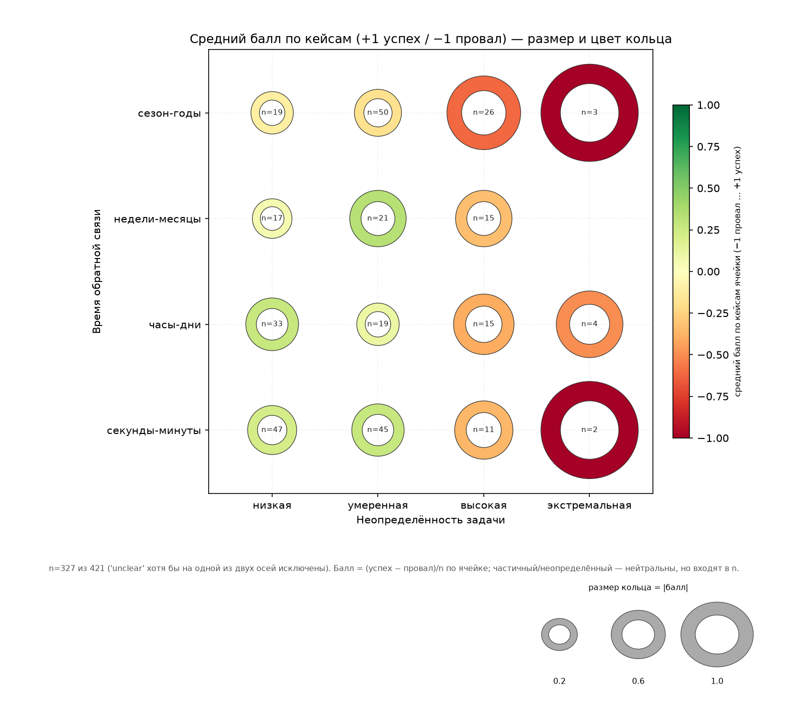

Одно кольцо на ячейку сетки (не точка на кейс): размер и цвет кольца — средний балл по кейсам,
попавшим в эту ячейку (успех = +1, провал = −1, частичный/неопределённый — нейтрально, но входят
в знаменатель; диапазон −1…+1, диверг. шкала RdYlGn с нулём на жёлтом); число в полом центре —
`n` кейсов в ячейке, чтобы объём ячейки оставался виден. n=327 из 421 (94 исключены как `unclear`
хотя бы по одной из двух осей). Данные — файлы 01-02.

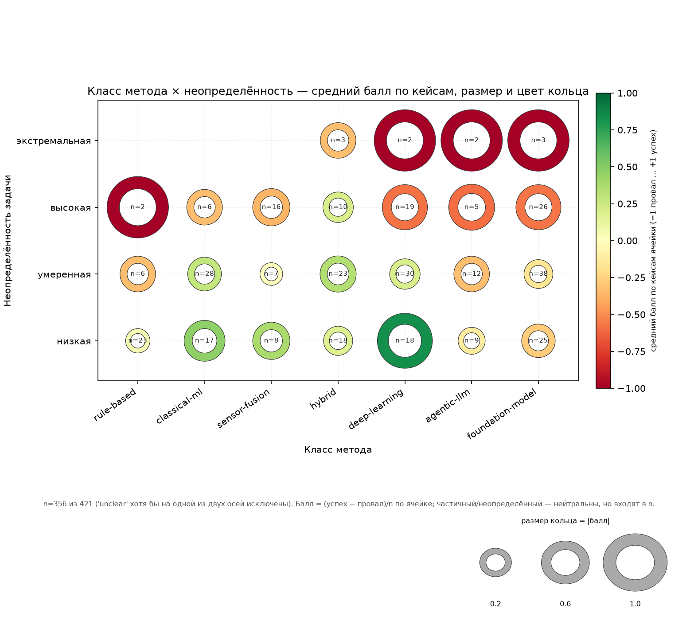

Та же конструкция (кольцо на ячейку, размер/цвет — средний балл, центр — `n`) по сетке класс
метода × неопределённость. Видно, где `rule-based`/`classical-ml` структурно исчезают на верхних
уровнях неопределённости (потолок попытки, файл 09 §1; на `extreme` для них n=0 — ячейки нет
вовсе), и где `foundation-model`/`agentic-llm`/`deep-learning` на `high`/`extreme` держат кольца
тёмно-малинового цвета даже при не самых маленьких `n`. n=356 из 421 (65 исключены как `unclear`).
Данные — файл 09 §1-2.

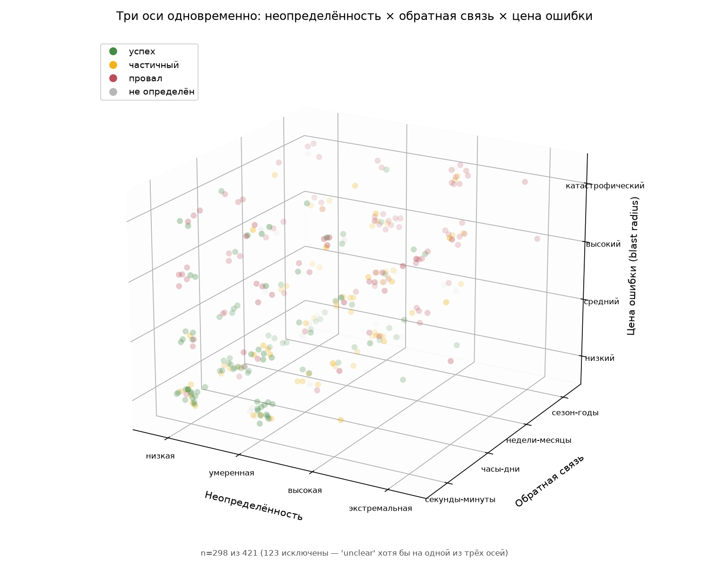

Все три оси сразу на одном облаке точек — ячейки решётки видны по глубине (панели осей
полупрозрачные), точки сгруппированы по комбинациям координат. n=298 из 421 (123 исключены как
`unclear` хотя бы по одной из трёх осей). Данные — файлы 01, 02, 07.

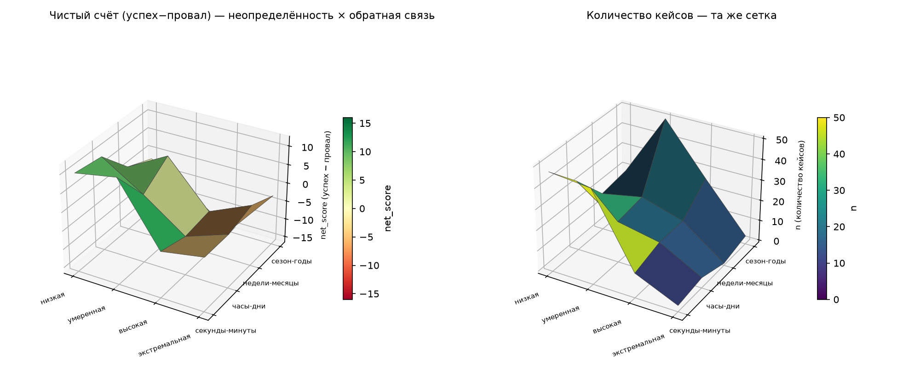

Настоящая 3D-поверхность (`plot_surface`, не scatter) на решётке 4×4. Слева — агрегированная
метрика `net_score = count(успех) − count(провал)` на каждую ячейку (частичный/неопределённый
исход — нейтральны), диверг. цветовая шкала RdYlGn с нулём на жёлтом; справа — та же сетка, но
`Z` = просто количество кейсов `n` в ячейке (viridis). Оба — по `axis1_level` × `axis2_bucket`.

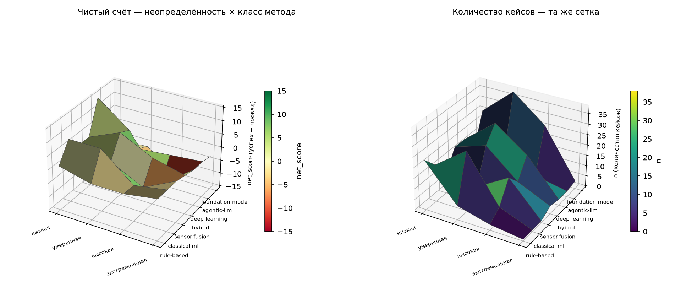

Та же пара (net_score слева, n справа), но решётка 4×7 — `axis1_level` × `axis3_class` (7
классов метода в фиксированном порядке rule-based → foundation-model).

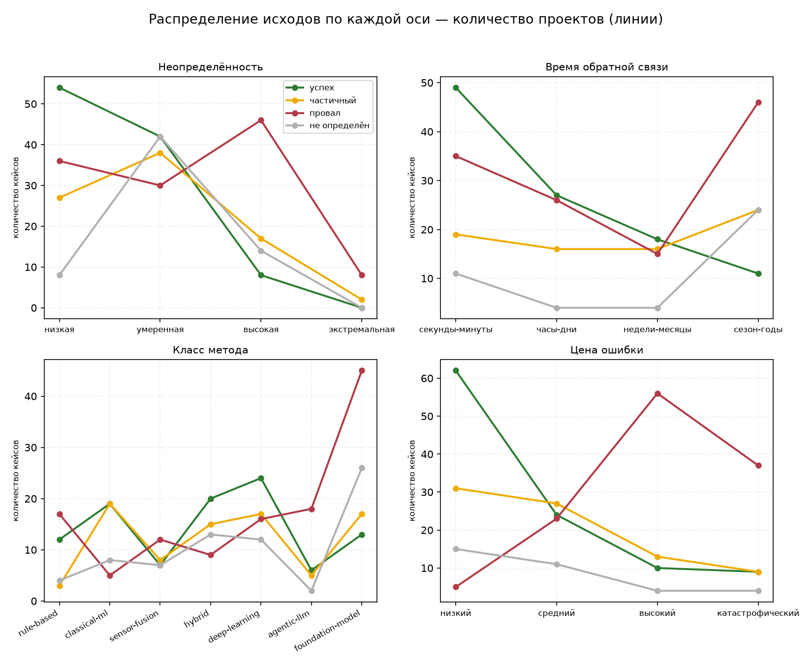

2×2: для каждой из 4 осей (неопределённость / обратная связь / класс метода / цена ошибки) —
линии «количество кейсов» по 4 исходам (успех/частичный/провал/не определён) с маркерами на
каждом уровне, та же цветовая схема, что и на точечных картах выше. Линии вместо столбцов —
по запросу владельца, чтобы рост/падение количества читалось сразу направлением линии.

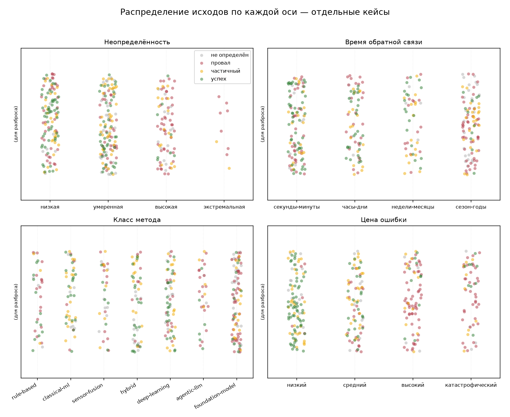

Та же раскладка 2×2 и те же 4 оси, но вместо линий — каждый кейс отдельной точкой
(джиттер по X для разлепления, Y — чисто для визуального разброса, без смысла), цвет — исход.
«Точечная» версия того же распределения, что и линейный график выше — видна плотность/смесь
исходов напрямую, без агрегации.

> Графики построены локальным Python + matplotlib + `mpl_toolkits.mplot3d` напрямую из сырых строк
> `reestr-reshenij.csv` (без промежуточной агрегации в проценты) — замена прежних 4
> агрегированных bar/line графиков по запросу владельца курса («графики не особо, давай точечные
> диаграммы и какую-нить трёхмерную»). Второй раунд (поверхности + распределения) — по запросу
> владельца построить агрегированную метрику успешности (+1 успех, −1 провал, количество
> отдельно) и показать распределения успех/провал по осям тремя способами: точками, столбцами по
> количеству, поверхностью по двум осям. dpi=150, см. `assets/make_charts.py`.

### Группы метода: классика vs МЛ vs большой ИИ — успех и провал

> Третий раунд — по запросу владельца: «а где графики отдельно по количеству успехов/провалов?
> барчарты переделай на графики и сделай в таких же (по каждой оси) график успеха и провала
> классики, МЛ, большого ИИ, ну и пофантазируй ещё графиков пока нет вау». Группы: Классика =
> `axis3_class=rule-based` (n=36), МЛ = `classical-ml` (n=51), Большой ИИ = `foundation-model` +
> `agentic-llm` (n=132); deep-learning/sensor-fusion/hybrid в это сравнение не входят.

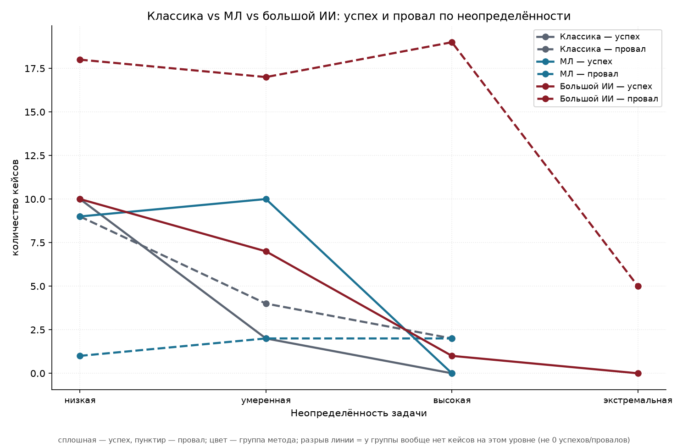

6 линий (3 группы × успех/провал, сплошная=успех, пунктир=провал) по 4 уровням
неопределённости; разрыв линии = у группы нет кейсов на этом уровне (не 0 успехов/провалов).

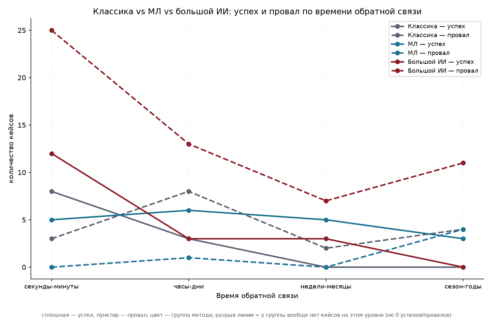

Та же схема (6 линий, цвет=группа, стиль=исход), ось — время обратной связи.

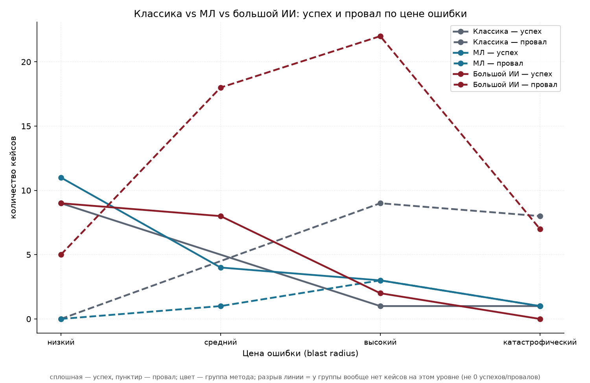

Та же схема, ось — цена ошибки (blast radius); у классики нет кейсов со средней ценой ошибки
(разрыв линии на этом уровне).

### «Вау»-графики

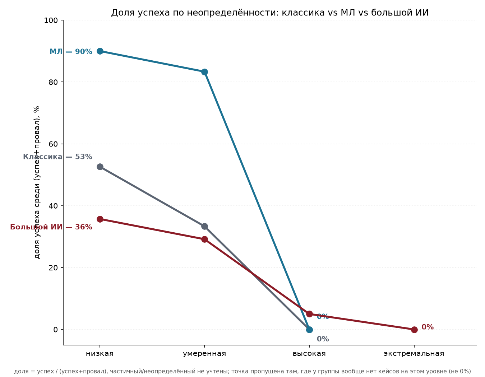

Bump/slope-chart — доля успеха (успех/(успех+провал), %) по 4 уровням неопределённости, одна
линия на группу, подписи значений прямо у концов линий. МЛ стартует выше всех (90%), классика —
посередине (53%), большой ИИ — ниже всех (36%); все три к высокой неопределённости обваливаются
к нулю (МЛ и классика — уже на «высокой», большой ИИ догоняет их на «экстремальной»).

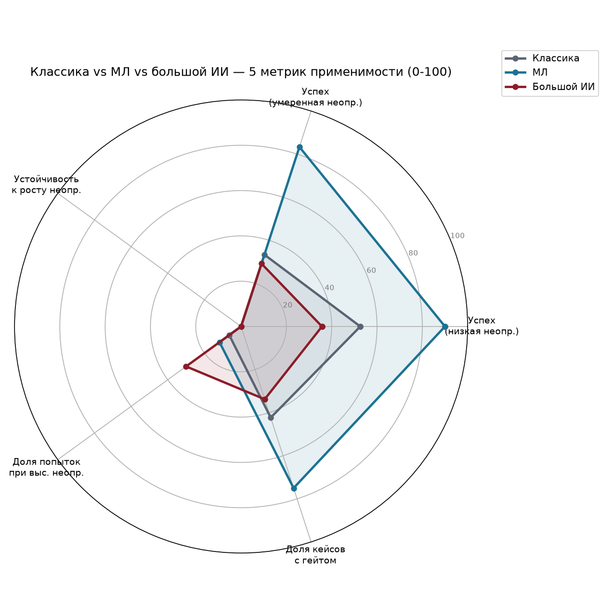

Радар на 5 нормированных метриках 0-100 (успех при низкой/умеренной неопределённости,
устойчивость к росту неопределённости, доля попыток при высокой неопределённости, доля кейсов с
гейтом) — один полигон на группу. Метрика «устойчивость» равна 0 у всех трёх групп: у каждой
доля успеха на её собственном потолке неопределённости падает ровно до 0%.

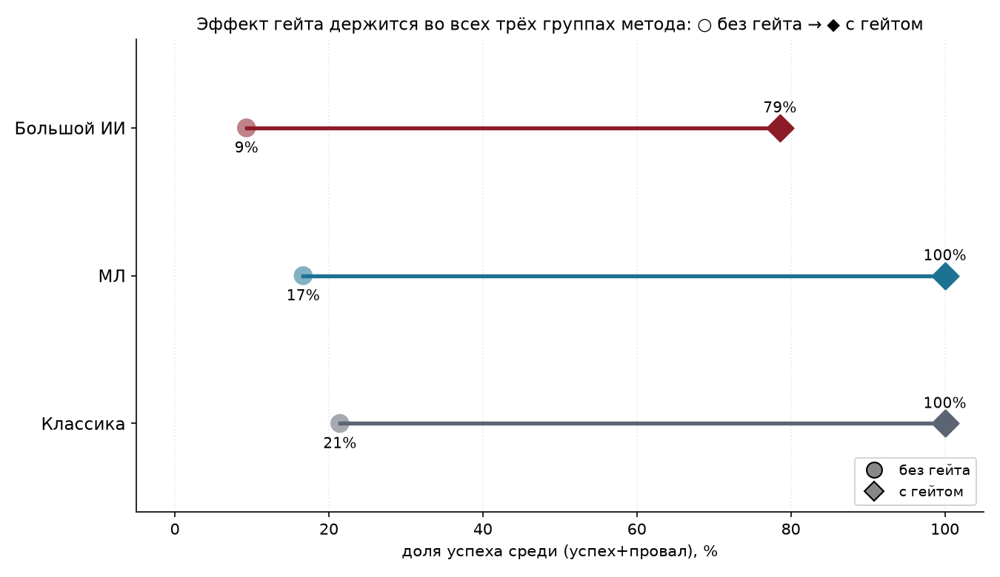

Опциональный третий «вау»-график: проверяет, держится ли самый сильный предиктор исхода всего
исследования (наличие гейта/обратимости, файл 07 §1) одинаково во всех трёх группах метода.
Держится: доля успеха без гейта/с гейтом — классика 21%→100%, МЛ 17%→100%, большой ИИ 9%→79%.

### Раунд 4: те же два семейства графиков, но доля от тотала вместо количества

> По запросу владельца: «распределение исходов и другие графики с разбивкой по типам по
> количеству сделай еще не по количеству, а по доле от тотала в этом срезе». Смысл: уровень оси
> с большим n (например `axis1_level=moderate`, n=152) «выигрывает» по количеству просто за счёт
> объёма, а не состава исходов; `axis1_level=extreme` (n=10) на фоне этого выглядит незначительным,
> хотя именно там — самая высокая доля провала. Доля убирает эффект объёма и показывает состав.
> Счётные версии НЕ изменены — обе пары графиков стоят рядом для сравнения.

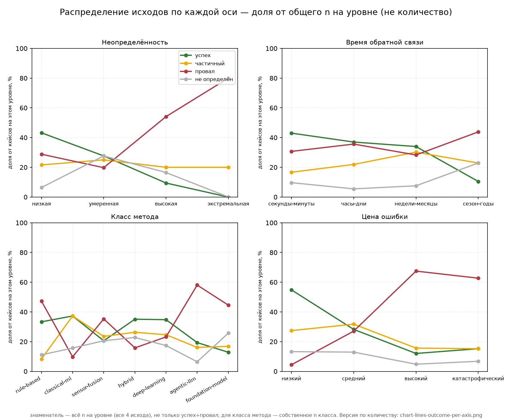

Долевая версия `chart-lines-outcome-per-axis.png` (сравнивать рядом). Тот же 2×2, те же 4 линии
на панель, но Y = `count(исход, уровень) / total_n(уровень) × 100` — процент от ВСЕХ кейсов на
этом уровне (все 4 исхода, не только успех+провал); 4 линии на каждом x суммируются в ~100%.
Знаменатели: `axis1_level` low=125/moderate=152/high=85/extreme=10; `axis2_bucket`
seconds-minutes=114/hours-days=73/weeks-months=53/season-years=105; `axis4_blast_radius`
low=113/medium=85/high=83/catastrophic=59; `axis3_class` — собственное n класса (foundation-model
=101, deep-learning=69, hybrid=57, classical-ml=51, rule-based=36, sensor-fusion=34,
agentic-llm=31 — у оси 3 нет отдельного «итога по всей оси», каждый класс сам себе срез).

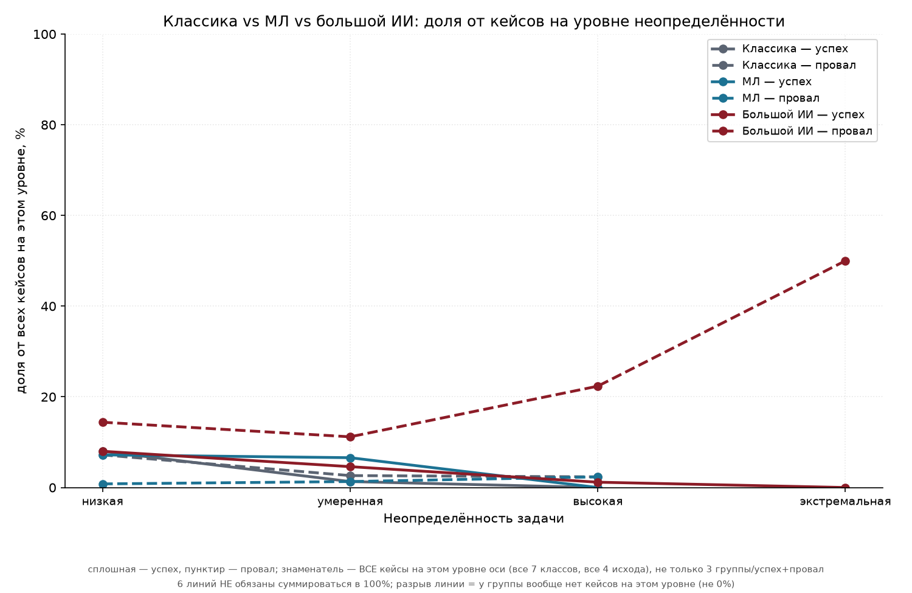

Долевая версия `chart-groups-axis1-uncertainty.png`. Те же 6 линий (3 группы × успех/провал,
сплошная/пунктир), но Y = `count(группа, исход, уровень) / total_n(уровень) × 100`, где
знаменатель — ВСЕ 125/152/85/10 кейсов на уровне неопределённости (across всех 7 классов, все 4
исхода) — не только три именованные группы и не только успех+провал, поэтому 6 линий НЕ обязаны
суммироваться в 100%. Разрыв линии = у группы вообще нет кейсов на этом уровне (честный пропуск,
не 0%). Самое заметное отличие от счётной версии — экстремальная неопределённость: по количеству
там всего 5 провалов большого ИИ, незаметно на фоне остальных уровней; по доле это 50% от всех
10 кейсов экстремального уровня — больше половины всего, что происходит на этом уровне, это
провал большого ИИ, а классики и МЛ там нет вовсе.

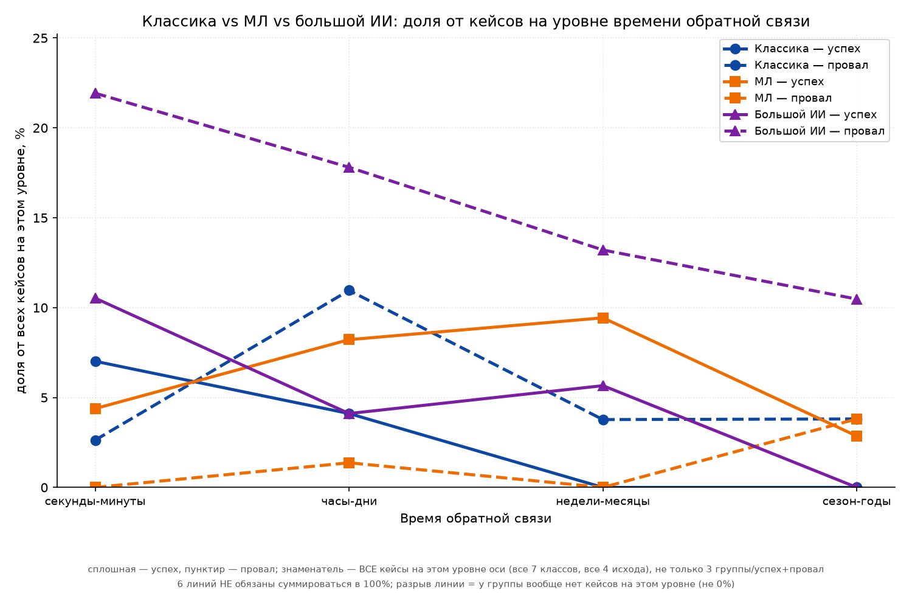

Та же схема, знаменатель — 114/73/53/105 кейсов на уровне времени обратной связи
(`chart-groups-axis2-feedback.png` — счётная пара).

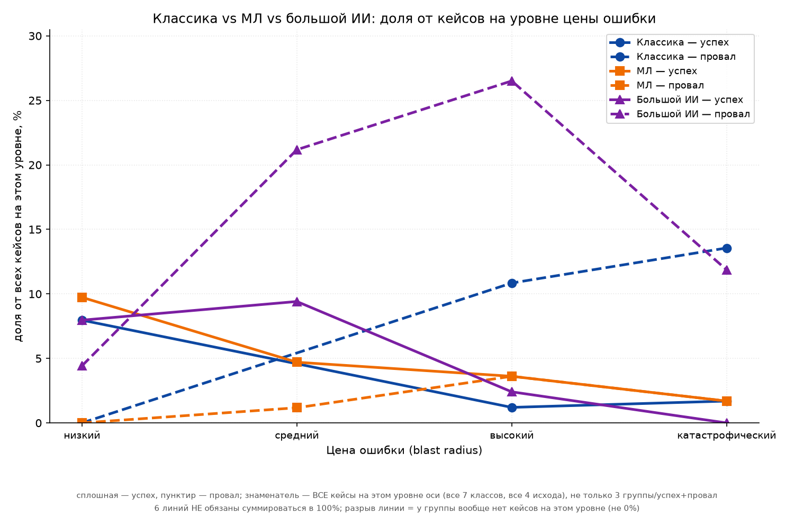

Та же схема, знаменатель — 113/85/83/59 кейсов на уровне цены ошибки
(`chart-groups-axis4-blastradius.png` — счётная пара). Провал большого ИИ по доле растёт от
низкого к высокому blast radius (4%→21%→26%), но на катастрофическом уровне падает обратно к
12% — не монотонный рост, который по чистому count-графику легко принять за линейный тренд.

### Раунд 7: отрасль как ось + рейтинг факторов + детализация механизмов (файл 10)

> По запросу владельца: «сделай оси более детальными... пока не видно прям бомбы». Разбор —
> `10-industriya-i-rejting-faktorov.md`. Формула успеха здесь и только здесь — пояснена заново
> в файле 10 §0 (чистая success/(success+failure), не путать с 75,4%/18,2% файла 07).

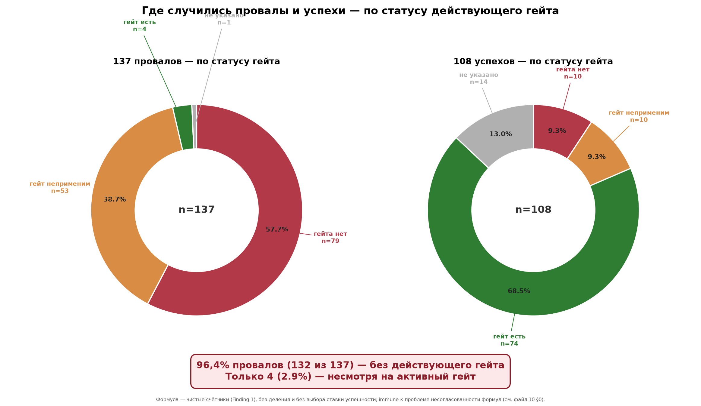

Самая чистая находка всей линии: из 137 провалов только 4 (2,9%) случились при действующем
гейте; 96,4% провалов — там, где гейта либо не было, либо он структурно не применялся. Чистые
счётчики, без формулы успеха вообще (файл 10 §1).

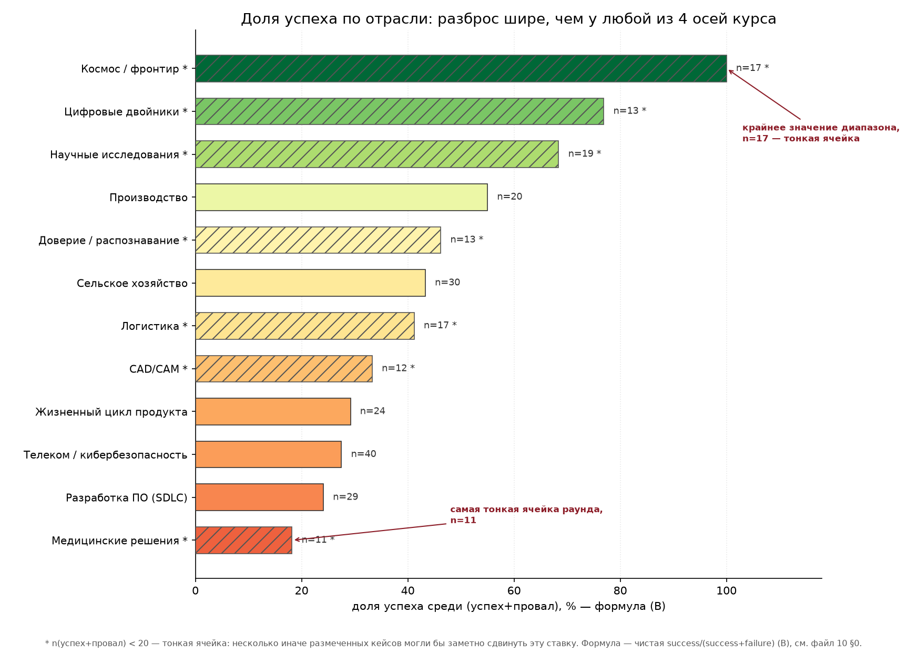

Отрасль как неиспользованная ось: разброс 100,0% (космос, n=17) до 18,2% (медицина, n=11) =
81,8 п.п., шире любой из 4 осей курса кроме гейта. Обе крайние точки — тонкие ячейки, честно
помечены на графике (файл 10 §2).

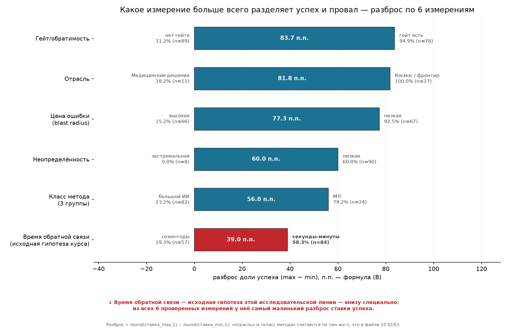

Рейтинг всех проверенных измерений по разбросу: гейт (83,7 п.п.) → отрасль (81,8) → цена ошибки
(77,3) → неопределённость (60,0) → класс метода (56,0) → время обратной связи (39,0, выделено
отдельным цветом — это исходная гипотеза курса, и она последняя, файл 10 §3).

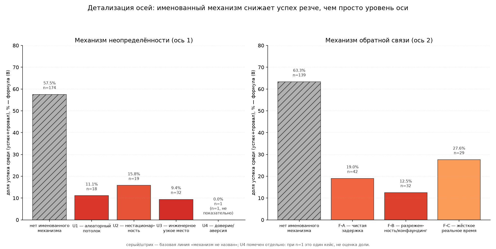

Детализация осей 1-2 до уровня именованного механизма: как только у кейса назван *какой-то*
механизм (любой из U1-U4 или F-A/F-B/F-C) — успех обрушивается относительно базовой линии «без
названного механизма» (9-28% против 57-63%). U4 (n=1) помечен как не показательный и на
графике, и в тексте (файл 10 §4).

### Раунд 8: пять «разрывающих» иллюстраций — по 2-4 находки в кадре (файл 11)

> По реакции владельца на раунды 1-7: «все равно что-то не цепляет» — с явным требованием,
> чтобы исполнитель придумал углы сам, без подсказанных тем. Полный разбор каждого кадра
> (все числа, формулы, почему выбран именно этот угол) — `11-pyat-razryvayushchih-illyustraciy.md`.
> Формула успеха — (B), как в раунде 7; графики 2 и 4 — чистые счётчики без формулы.

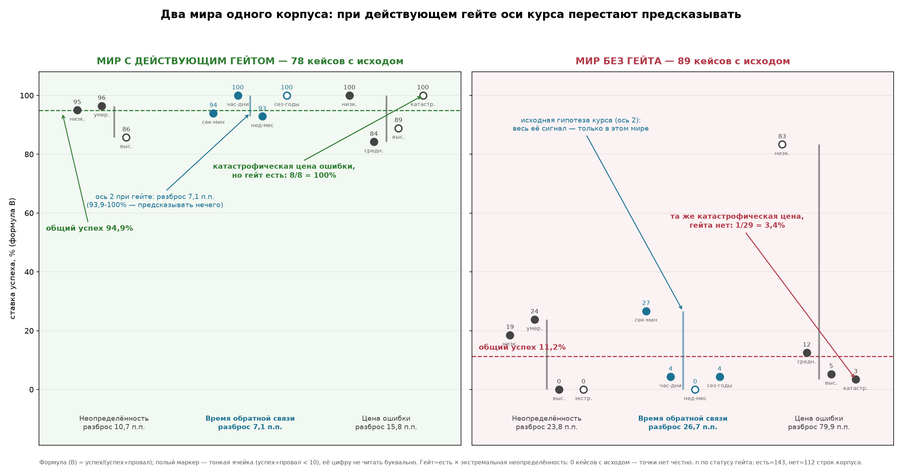

Две панели: 143 кейса с гейтом (успех 94,9%, разброс по осям 7-16 п.п. — предсказывать нечего)
против 112 без гейта (успех 11,2%, разброс до 79,9 п.п.). Вся предсказательная сила осей курса —
условная, живёт в мире без гейта; катастрофическая цена ошибки при гейте — 8/8 = 100%, без —
1/29 = 3,4%.

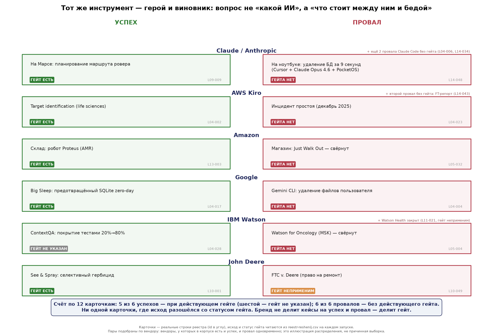

12 именных карточек (Claude на Марсе vs Claude удаляет БД за 9 секунд; Kiro, Amazon, Google,
Watson, Deere): бренд не делит кейсы на успех и провал — делит гейт (5 из 6 успехов при гейте,
6 из 6 провалов без действующего гейта, ни одного расхождения).

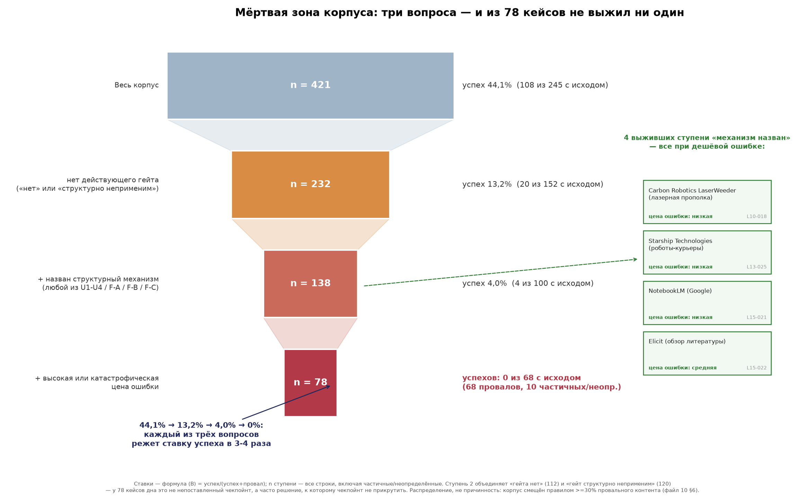

421 → 232 (нет гейта) → 138 (+ назван механизм U/F) → 78 (+ высокая/катастрофическая цена):
ставка 44,1% → 13,2% → 4,0% → **0,0%**. Четыре выживших предыдущей ступени поимённо — все при
дешёвой ошибке.

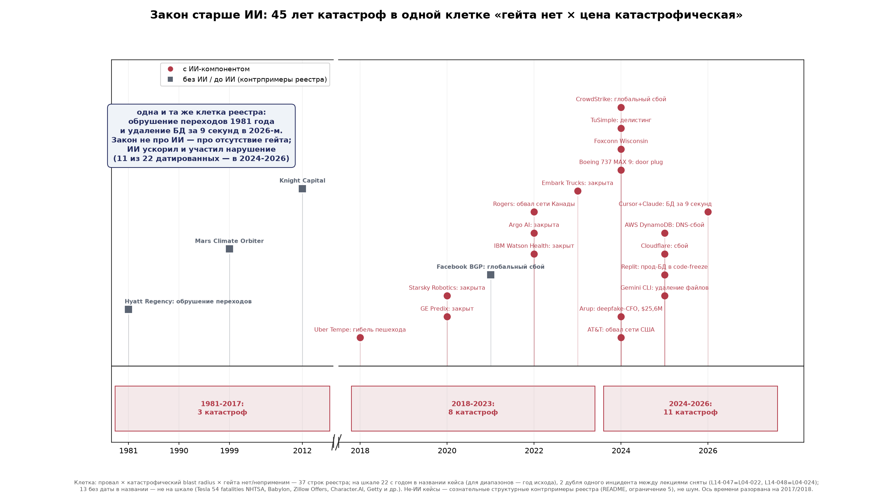

Клетка «провал × катастрофическая цена × гейта нет» содержит Hyatt Regency 1981, Mars Climate
Orbiter 1999, Knight Capital 2012 — не-ИИ контрпримеры реестра — рядом с Uber Tempe, CrowdStrike
и «БД за 9 секунд» 2026-го. Закон не про ИИ; ИИ ускорил и участил нарушение: 3 катастрофы за
1981-2017, 11 — за 2024-2026.

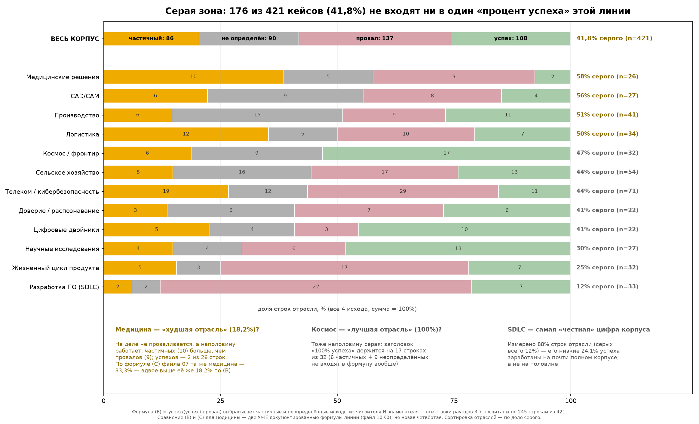

41,8% корпуса (86 частичных + 90 неопределённых) невидимы для формулы (B); серость от 12% (SDLC)
до 58% (медицина). «Худшая отрасль» (медицина 18,2%) на деле наполовину работает (частичных
больше, чем провалов), и по формуле (C) её же ставка — 33,3%; «лучшая» (космос 100%) держится
на 17 строках из 32.

## Финальная рамка: две ядровые оси + отдельная ось риска

1. **Ось A — неопределённость и фронт применимости методов.** Слияние старой оси 1
   (неопределённость: низкая/умеренная/высокая/экстремальная) и старой оси 3 (сложность модели).
   Сложность модели никогда не вела себя как независимое измерение, которое можно скрещивать с
   неопределённостью — чистой инвертированной U не нашлось ни разу (файл 08 §2.3, 6 из 7 классов
   падают монотонно). Правильнее описывать как функцию двух параметров ОТ неопределённости, своих
   для каждого класса метода: **потолок** (до какого уровня неопределённости класс вообще
   доходит) и **наклон** (насколько резко падает успех в своём диапазоне) — файл 09 §2.2. Это же
   поглощает историческую динамику (файл 04): появление новых классов методов во времени — это и
   есть механизм, которым потолок двигается вправо (rule-based → classical-ml → deep-learning →
   foundation-model/agentic-llm).
2. **Ось B — скорость обратной связи.** T_outcome (секунды-минуты/часы-дни/недели-месяцы/
   сезон-годы) с тремя механизмами: F-A (чистая задержка), F-B (разреженность/конфаундинг), F-C
   (допуск по жёсткому/мягкому реальному времени). Остаётся независимой — не сводится к оси A:
   файл 08 §1 показывает, что F-A/F-B/F-C по-разному (хоть и слабо, зашумлённо) совместимы с
   гейтом, а одна неопределённость этого не предсказывает.
3. **Отдельно — гейт/обратимость + blast radius.** Эмпирически сильнейший одиночный предиктор
   всего исследования (см. числа выше). Представлена как ортогональная осям A/B — это вопрос
   цены/обратимости ошибки, а не того, работает ли метод технически. Полное слияние гейта в оси
   A/B не проверялось и не подтверждено — это текущая лучшая структура, открытая к пересмотру
   (файл 09 §3.3).

## Что эта заметка НЕ устанавливает

- **Не оригинальное научное открытие и не калиброванный закон.** Ни одна из операционализаций
  (потолок/наклон, T_outcome-бакеты, blast radius) не является проверенной формулой с порогами —
  это педагогический синтез для курса, не переоткрытие консенсуса (файл 01 §6, файл 02 §8).
- **Слияние гейта в оси A/B — не решено.** Представление «гейт отдельно» — рекомендация
  оркестратора (файл 09 §3.3), не дословно подтверждённая владельцем формулировка.
- **Потолок/наклон держится на тонких хвостах.** Ячейки «экстремальная неопределённость» для
  deep-learning/foundation-model/agentic-llm/hybrid — n=2-3 каждая (файл 09 §2.4, §4.5); одна
  иначе размеченная строка меняет процент на десятки пунктов.
- **Метод извлечения чисел измеримо нестабилен при повторной реализации** — независимые проходы
  по одному и тому же корпусу дают разные числа даже при формально одном правиле (файл 07 §6в).
  Все числа этого файла — порядок величины и направление, не воспроизводимая статистика.
- **Выборка курса смещена требованием ≥30% провального контента** (CLAUDE.md) — абсолютные ставки
  успешности нерепрезентативны для индустрии в целом; относительные сравнения между уровнями/
  классами — более надёжны (все файлы линии, последний раз файл 09 §4.6).
- **Одноразмечающая разметка без межрейтерской проверки** — ни один круг (06-10) этого не снял.
- **Три несведённые формулы «ставки успешности»** накопились по ходу линии (net/n, чистая
  success/(success+failure), partial-взвешенная) — файл 10 §0 впервые называет это прямо и
  фиксирует формулу для своих собственных вычислений; файлы 06-09 остаются историческим
  слепком со своими формулами, задним числом не переписаны.

## Карта всей линии исследования (00-11)

| Файл | Содержание |
|---|---|
| `00-rezyume.md` | Этот файл — исполнительное резюме финальной рамки (текущая версия) |
| `01-os-neopredelennosti.md` | Литературный обзор оси неопределённости (U1-U4) |
| `02-os-fidbeka.md` | Литературный обзор оси скорости обратной связи (F-A/F-B/F-C) |
| `03-slozhnost-modeli.md` | Литературный обзор гипотезы «сложность модели — инвертированная U» (гипотеза, позже эмпирически отвергнута) |
| `04-istoricheskaya-dinamika.md` | Литературный обзор исторического сдвига фронтира методов |
| `05-sintez-i-kriticheskaya-karta.md` | Детальный синтез финальной рамки + самокритика (текущая версия) |
| `prozharka.md` | Адверсариальная прожарка файлов 00-05 (первой версии рамки) |
| `06-korrelyaciya-s-realnymi-keysami.md` | Агрегатная корреляция трёх исходных осей по всем 421 кейсам |
| `07-os4-gejt-i-vneshnij-shum.md` | Открытие 4-й оси (гейт/обратимость) + тест исключения внешнего шума |
| `08-gejt-mehanizm-i-klassy-metodov.md` | Кросс-таб гейт×механизм фидбека; ось1×ось3 — проверка инвертированной U (не найдена) |
| `09-klassika-vs-ii-i-pereborka-osej.md` | Классика-vs-ИИ: потолок попытки vs потолок успеха; предложение схлопнуть оси |
| `10-industriya-i-rejting-faktorov.md` | Отрасль как ось + рейтинг разброса по 6 измерениям + детализация механизмов U1-U4/F-A-C; первая явная фиксация формулы успеха линии |
| `11-pyat-razryvayushchih-illyustraciy.md` | Пять иллюстраций по 2-4 находки в кадре: два мира гейта; герой-и-виновник по вендорам; мёртвая зона 0/78; хроника катастроф 1981-2026; серая зона 41,8% |
| `reestr-reshenij.csv` + `reestr-reshenij-README.md` | Канонический датасет — 421 размеченный реальный кейс |
